# Práctica 1.4 — HTTPS con certificado autofirmado en Apache

## Introducción

El objetivo de esta práctica es desplegar un servidor web Apache en una instancia EC2 de AWS, configurando HTTPS mediante un certificado autofirmado.

Para ello se han creado dos scripts Bash que automatizan la instalación de Apache y la configuración del certificado SSL. También se han utilizado dos plantillas de configuración para los Virtual Hosts HTTP y HTTPS.

## Configuración realizada

Se ha creado una instancia EC2 con Ubuntu Server y se le ha asociado una IP elástica: `18.215.58.228`.

En el Security Group se han habilitado las siguientes reglas de entrada:

- SSH: TCP 22.
- HTTP: TCP 80.
- HTTPS: TCP 443.

También se ha configurado el archivo `hosts` del equipo local para asociar la IP elástica al dominio `practica-https.test`:

```text
18.215.58.228 practica-https.test
```

## Scripts desarrollados

### install_apache.sh

Este script automatiza la instalación de Apache.

Sus principales funciones son:

1. Comprueba mediante `dpkg -s apache2` si Apache ya está instalado.
2. Si ya está instalado, muestra un mensaje y termina sin volver a instalarlo.
3. Si no está instalado, realiza la instalación mediante `apt` sin intervención del usuario.
4. Habilita y arranca el servicio Apache.

### setup_selfsigned_certificate.sh

Este script configura HTTPS utilizando un certificado autofirmado.

Sus principales funciones son:

1. Comprueba que Apache está instalado.
2. Lee las variables de configuración del archivo `.env`.
3. Comprueba que existen las plantillas de configuración dentro de `conf/`.
4. Genera un certificado autofirmado y su clave privada mediante OpenSSL.
5. Incluye el dominio y la IP elástica en la extensión `subjectAltName`.
6. Protege los permisos de la clave privada.
7. Copia las plantillas a la configuración de Apache sustituyendo los marcadores mediante `sed`.
8. Habilita los módulos `ssl` y `rewrite`, así como los sitios correspondientes.
9. Comprueba la sintaxis de Apache con `apache2ctl configtest` antes de reiniciar el servicio.

### Plantillas de configuración

- `000-default.conf`: configura el Virtual Host HTTP en el puerto 80 y redirige las peticiones a HTTPS.
- `practica-https-ssl.conf`: configura el Virtual Host HTTPS en el puerto 443 y establece las rutas del certificado y de la clave privada.

El archivo `.env` contiene los datos específicos de la configuración. Se incluye `.env.example` en el repositorio como plantilla, pero no se sube el `.env` real.

## Verificaciones y evidencias

### Parte 1: Instalación de Apache

Se ejecuta el script `install_apache.sh` para instalar Apache en la instancia EC2.

A continuación, se muestran el script utilizado, el resultado de la instalación y el estado del servicio.

**Código del script de instalación:**

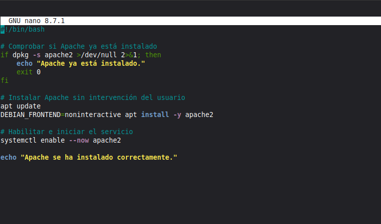

**Resultado de la instalación:**

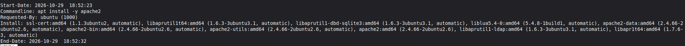

**Comprobación del estado del servicio:**

Se utiliza el siguiente comando:

```bash
systemctl status apache2
```

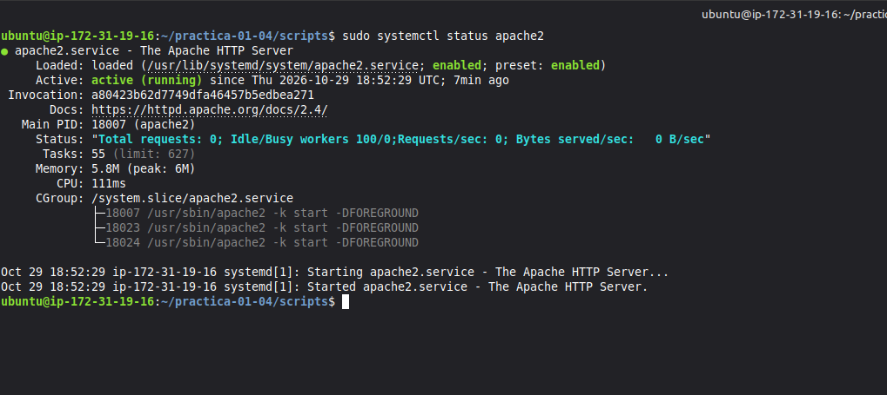

El resultado confirma que Apache está activo (`active (running)`) y habilitado (`enabled`).

### Parte 2: Reejecución del script de instalación

Se vuelve a ejecutar el script:

```bash
sudo ./scripts/install_apache.sh
```

Como Apache ya está instalado, el script detecta su presencia y termina sin realizar una nueva instalación.

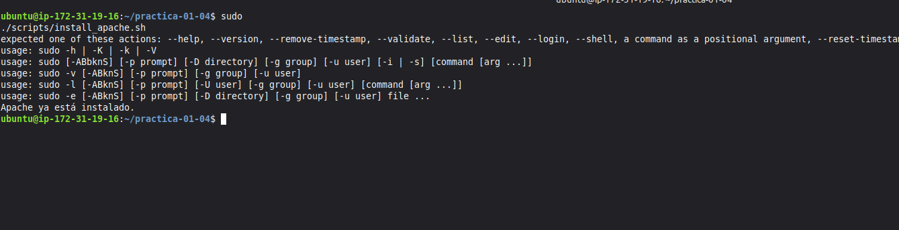

### Parte 3: Comprobación del certificado

Se comprueba el sujeto, el periodo de validez y la extensión `subjectAltName` del certificado:

```bash
openssl x509 -in /etc/ssl/certs/apache-selfsigned.crt -noout -subject -dates -ext subjectAltName
```

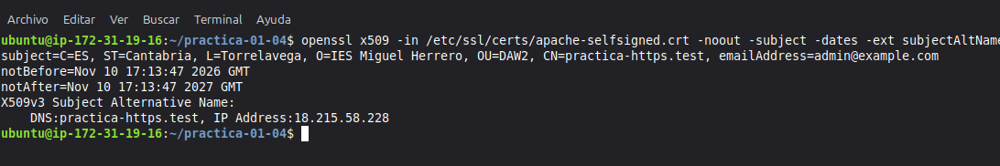

El certificado contiene los datos de configuración definidos en el archivo `.env`.

Su periodo de validez es de 365 días y contiene tanto el dominio `practica-https.test` como la IP elástica `18.215.58.228` en el SAN.

### Parte 4: Comprobación de la sintaxis de Apache

Se ejecuta:

```bash
sudo apache2ctl configtest
```

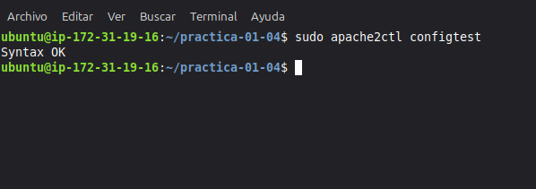

El resultado obtenido es:

```text
Syntax OK
```

Esto indica que la configuración de Apache no presenta errores de sintaxis.

### Parte 5: Comprobación de los puertos

Se utiliza el siguiente comando para comprobar los puertos en los que Apache está escuchando:

```bash
sudo ss -tlnp | grep apache2
```

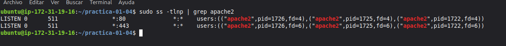

Se comprueba que Apache escucha en los puertos 80 (HTTP) y 443 (HTTPS).

### Parte 6: Redirección HTTP a HTTPS

Desde el equipo local se ejecuta:

```bash
curl -I http://practica-https.test
```

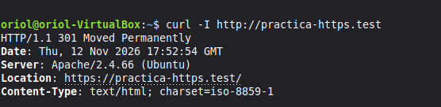

La respuesta obtenida es:

```text
HTTP/1.1 301 Moved Permanently
Location: https://practica-https.test/
```

La respuesta `301` confirma que las peticiones HTTP se redirigen correctamente a HTTPS.

### Parte 7: Respuesta HTTPS

Se comprueba el acceso HTTPS mediante:

```bash
curl -Ik https://practica-https.test
```

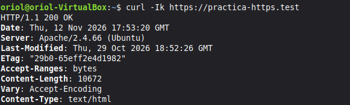

La respuesta obtenida es:

```text
HTTP/1.1 200 OK
```

La opción `-k` permite realizar la petición aunque el certificado sea autofirmado y no esté firmado por una autoridad certificadora de confianza.

### Parte 8: Negociación TLS

Se utiliza OpenSSL para comprobar la negociación TLS con el servidor:

```bash
openssl s_client -connect practica-https.test:443 -servername practica-https.test < /dev/null
```

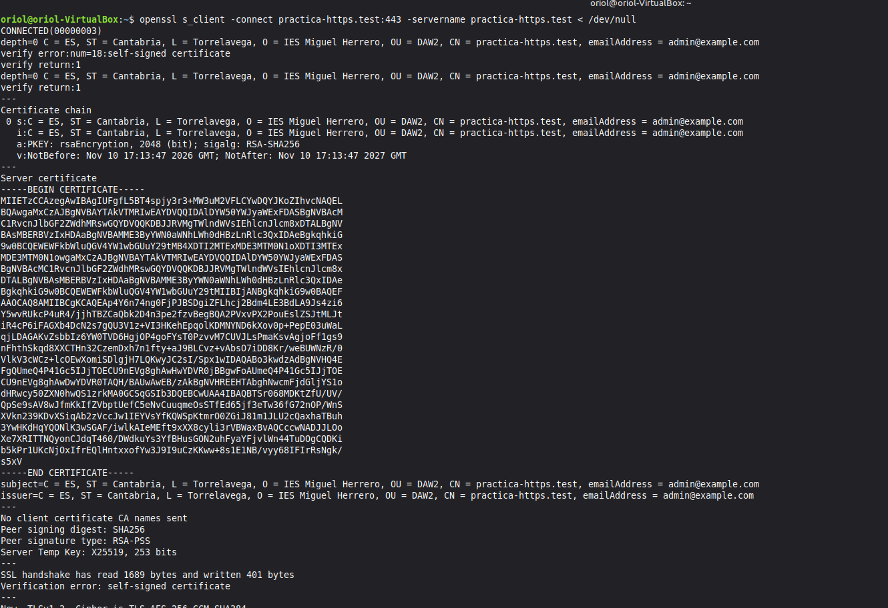

La salida del comando permite comprobar la versión del protocolo TLS negociado, el cifrado utilizado y el certificado presentado por Apache.

Al tratarse de un certificado autofirmado, es normal que OpenSSL indique que no puede verificar la cadena de confianza.

### Parte 9: Acceso desde el navegador

Finalmente, se accede a la dirección:

```text
https://practica-https.test
```

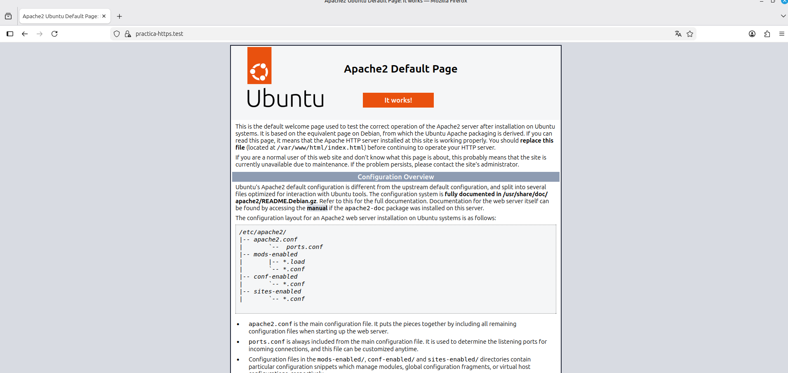

El navegador muestra un aviso de seguridad debido a que el certificado es autofirmado. Tras aceptar la excepción, se puede acceder correctamente a la página predeterminada de Apache de Ubuntu.

También se comprueban los detalles del certificado para verificar sus datos y el dominio asociado.

## Problemas y dificultades

Durante la práctica se encontró una dificultad al subir los archivos al repositorio de GitHub.

Inicialmente se intentó utilizar HTTPS para realizar el `push`, pero GitHub no permitió autenticarse utilizando la contraseña habitual de la cuenta.

Para solucionarlo, se configuró el acceso mediante SSH, generando una clave SSH y añadiendo su clave pública a GitHub. Después se modificó la dirección del repositorio remoto para utilizar SSH y se pudo subir el contenido correctamente.

## Estructura del repositorio

```text
practica-01-04/
├── README.md
├── .gitignore
├── evidencias/
│   ├── image.png
│   ├── image2.png
│   ├── image3.png
│   ├── image4.png
│   ├── image5.png
│   ├── image6.png
│   ├── image7.png
│   ├── image8.png
│   ├── image9.png
│   ├── imagea.png
│   └── imageb.png
├── conf/
│   ├── 000-default.conf
│   └── practica-https-ssl.conf
└── scripts/
    ├── .env.example
    ├── install_apache.sh
    └── setup_selfsigned_certificate.sh
```

El archivo `.env` real y las claves privadas no se incluyen en el repositorio por motivos de seguridad.
